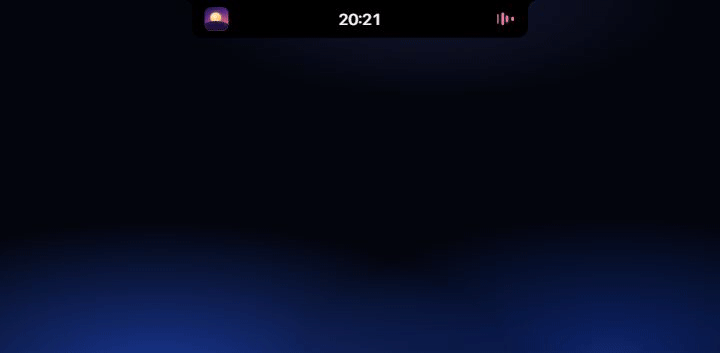
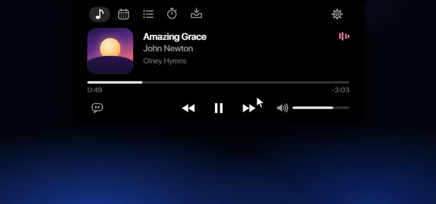
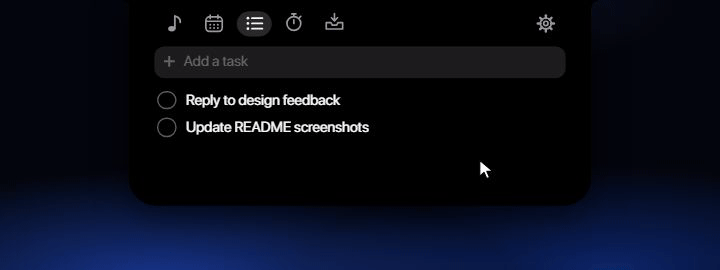
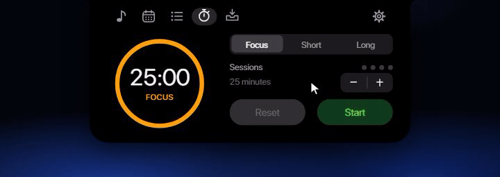
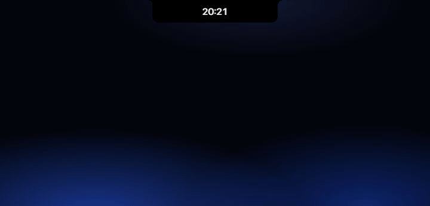
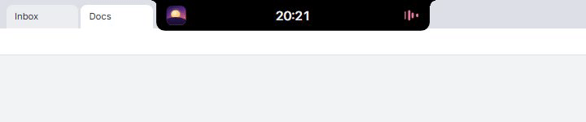
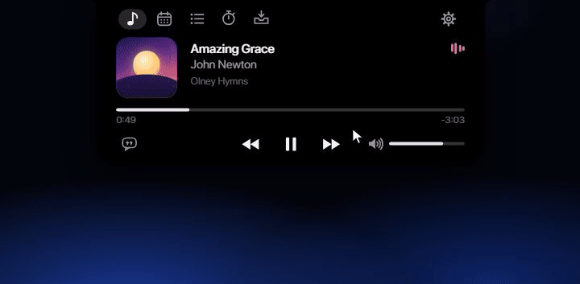

<div align="center">

# Wisp

**A Dynamic Island–style notch for Windows, inspired by Apple's design.**

🙏 **Thanks for contributing, [@overhaulpxl](https://github.com/overhaulpxl)!** Per-app volume, the calendar schedule and a lighter idle footprint are their work.

It sits at the top of your screen, shows what's playing and your notifications, and opens into a small panel with lyrics, a calendar, a to-do list, a Pomodoro timer and a file shelf. When it would hide something, it steps aside.


</div>

---

## Features

### 🎵 Now Playing
- Detects **Spotify**, **Apple Music** and **Spotifast** through Windows media sessions. Browsers and other apps are ignored.
- Shows the album artwork, title, artist and a scrubber you can click to seek, plus previous / play-pause / next controls.
- An activity waveform takes its color from the artwork.
- A **volume slider for the player only**: it moves Spotifast's own slider, and sets Spotify's, Chrome's or Edge's level in the Windows Volume Mixer. Your system volume and other apps stay as they are.

### 🎤 Synced lyrics
- Real-time lyrics in the style of Apple Music, from [LRCLIB](https://lrclib.net), with NetEase Cloud Music as a fallback for songs LRCLIB lacks. The current line is highlighted and the column glides to the next one on a spring.
- Click any line to jump to that point in the song.
- **Lyrics in the collapsed notch** as well: the current line sits in the closed bar, which widens smoothly to fit long lines.
- Lyrics are saved on your PC after the first load, so songs you've played before show them instantly, even offline. While LRCLIB is overloaded the notch says so and keeps retrying.



### 📅 Calendar
- A month view in the style of Apple's Calendar widget, with today marked in red. Flip through months and pick any date.
- **Your own schedule**: add, edit and delete events for the selected date (`09:30-10:00 Standup`, or just a title for 09:00). Dates with events get a marker.
- Scroll or swipe through every page; the panel reshapes itself for each one.



### ✅ To-do
- A checklist laid out like Apple Reminders. Type to add a task, click to check it off.
- Tasks are saved and survive a restart.



### ⏱️ Pomodoro
- Focus sessions, short breaks, and a long break after every fourth session: 25 / 5 / 15 minutes by default.
- **Adjust the length** of each with the − / + stepper between sessions (focus 5–90 min and long breaks 5–60 min in 5-minute steps, short breaks 1–30 min). Your lengths are saved.
- While the timer runs, the collapsed notch shows a live countdown.



### 🔔 Notifications
- Every Windows notification shows up in the notch. For about 5 seconds it springs open into a pill with the app's icon (or the sender's picture, for apps like Discord), the title, one line of the message, and the app's name.
- Hover to keep it open. Click to open the app.
- Works with any app, with no setup and no permission prompts.
- Windows still shows its own pop-up too. To see notifications only in the notch, turn off **Settings → System → Notifications → Show notification banners**, either for all apps or per app. Notifications still reach the Action Center, and Wisp still sees them.


### 📥 File shelf
- Drop files onto the notch to keep them close at hand. **Drag them back out** into Explorer, a chat or any other app.
- Drag one card onto another to group files into a folder.
- The shelf is saved, so it survives a restart.



### ✨ Feel
- Opens when you hover over it and closes when you move away. Every movement runs on springs, with no hard cuts.
- Switch pages with the tabs, the scroll wheel or a horizontal touchpad swipe.
- If two music apps are playing, Now Playing follows the one Windows shows in its media overlay, or the one you pick in Settings.

### 🪶 Minimal mode
- When the closed notch would hide something, such as browser tabs that reach it, it shrinks to a thin sliver at the top edge, so what's behind it stays visible and clickable.
- An empty title bar or tab strip behind it doesn't count, so the notch stays normal there.
- Hover the top edge to open it as usual.



### ⚙️ Settings
- A Settings page inside the notch, in Apple's dark-mode style: inset grouped cards, switches, and a segmented control for the music player.
- Open it from the gear at the right end of the header, or from the tray icon.



## Getting started

### Requirements
- Windows 10 or 11 (the notch appears on the primary display)
- [Rust](https://rustup.rs) with the `stable-x86_64-pc-windows-gnu` toolchain
- Optional: **SF Pro Display** from [Apple's font page](https://developer.apple.com/fonts/) for the exact Apple look. Without it, Wisp uses the bundled Inter font.

### Download

Grab the latest zip from **Releases**. It holds a single `wisp.exe` (no installer, no extra DLLs), `README-TESTER.txt` and `Inter-LICENSE.txt`. Unzip it and run `wisp.exe`; Windows may ask you to confirm because the app isn't signed (**More info → Run anyway**).

SF Pro can't be redistributed, so Wisp uses it when it's installed and otherwise the bundled [Inter](https://rsms.me/inter/) font, which is embedded in the exe.

### Build and run

```bash
cargo build --release
```

```bash
target/release/wisp.exe
```

The notch appears at the top center of your screen. The **Wisp** tray icon has **Settings…** and **Quit Wisp**.

### Settings

Settings have their own page in the notch: click the gear at the right end of the header, or choose **Settings…** from the tray icon. It follows Apple's dark-mode settings style, with inset grouped cards, switches, and a segmented control for the music player.

| Setting | Default | What it does |
|---|---|---|
| Open on hover | On | Off: the notch opens only when you click it |
| Shrink over content | On | The closed notch becomes a thin sliver while it would hide tabs, text or icons |
| Lyrics when closed | On | While lyrics are on, the sung line shows in the closed notch |
| Notifications | On | Windows notifications appear in the notch |
| 24-hour clock | On | Off: 2:25 instead of 14:25 |
| Match Windows motion | Off | On: no animations when Windows "Animation effects" is off |
| Start with Windows | Off | Launches Wisp when you sign in |
| Music player | Automatic | Which app Now Playing follows when several are open |

Settings are saved right away. "Start with Windows" adds or removes Wisp under your user's `Run` key in the registry.

## Usage

| Action | How |
|---|---|
| Open / close | Move the cursor over the notch / away from it |
| Switch pages | Click the header icons, scroll, or swipe horizontally |
| Show lyrics | Lyrics button at the bottom left of Now Playing |
| Seek | Click the scrubber or a lyric line |
| Add to the shelf | Drop files onto the notch |
| Take a file out | Drag its card out of the notch |
| Open a file's location | Right-click its card on the shelf |
| Open a notification's app | Click the notification pill |
| Close the panel | `Esc` |
| Settings | Gear tab in the notch, or tray icon → **Settings…** |
| Quit | **Quit Wisp** on the Settings page, or in the tray menu |

## Your data

Everything stays on your PC, in `%APPDATA%\Wisp\`:

| File | Contents |
|---|---|
| `settings.txt` | Your settings, including Pomodoro lengths |
| `todos.txt` | Your to-do list |
| `calendar.txt` | Your calendar schedule |
| `shelf.txt` | The file paths on your shelf (the files themselves aren't copied) |
| `lyrics\` | Cached lyrics |

The only network request is the lyrics lookup. It sends the current track's title, artist, album and duration to LRCLIB, and only when LRCLIB has no synced lyrics, the title and artist to NetEase Cloud Music (music.163.com), without cookies.

Notifications are read locally and read-only from Windows' own notification database. Wisp never stores, logs or sends them anywhere.

## How it's built

Wisp is a single native Rust executable written directly against Win32, with no UI framework.

- **Rendering**: a layered window drawn with GDI+ (antialiased shapes and SF Symbols-style icons) and GDI text, presented with `UpdateLayeredWindow`.
- **Animation**: spring physics, so changing direction mid-motion keeps the current speed. While the notch itself moves, frames are locked to the display (`DwmFlush`); while only small things move, a timer at the display rate runs them; at rest Wisp ticks about 10 times a second. Text, icons and artwork are cached, so a frame takes well under a millisecond.
- **Media**: Windows `GlobalSystemMediaTransportControlsSessionManager` for track info and playback control. The volume uses Spotifast's `spotifast volume` command, and the app's own Windows audio session (Volume Mixer) for Spotify, Chrome and Edge.
- **Lyrics**: a background worker using WinRT `HttpClient` that talks to LRCLIB (falling back to NetEase), with an on-disk cache.
- **Notifications**: read-only from the Action Center's database through the system's `winsqlite3.dll`.
- **Minimal mode**: walks the window z-order and checks the screen pixels beside the notch for content.
- **Files**: OLE drag-and-drop in both directions.

| Path | What it is |
|---|---|
| `src/main.rs` | Window, state, drawing and input |
| `src/render.rs` | Thin GDI+ wrapper |
| `src/media.rs` | Media session polling and control |
| `src/lyrics.rs` | LRCLIB and NetEase clients, LRC parsing, cache |
| `src/volume.rs` | The player's volume (Spotifast commands, per-app audio sessions) |
| `src/tasks.rs` | To-do and Pomodoro logic |
| `src/tray.rs` | Tray icon and its menu |
| `src/settings.rs` | Settings file and Start with Windows |
| `src/notify.rs` | Reads new Windows notifications |

For the full behavior reference (sizes, timings, every animation and edge case), see **[docs/BEHAVIOR.md](docs/BEHAVIOR.md)**.

### Tests

```bash
cargo test
```

```bash
cargo run --release -- --smoke-test
```

The smoke test drives the real window: it checks the expand/collapse sizes, placement, the shelf and mode transitions, then writes `PASS` or `FAIL` to `smoke-result.txt`.

## Limitations

- Lyrics depend on LRCLIB, a free community service, and NetEase's unofficial web API as a fallback. Some songs are still missing, LRCLIB is sometimes overloaded, and NetEase may change its API without notice.
- The notch appears on the primary display only.
- Notifications come from Windows' notification database, which isn't an official API. A future Windows update could change it; if that happens, the notch simply stops showing notifications.

## Credits

- Contributors: [@overhaulpxl](https://github.com/overhaulpxl) (per-app volume, calendar schedule, idle performance).
- Lyrics from [LRCLIB](https://lrclib.net), a free, open lyrics database (please be kind to their servers), with NetEase Cloud Music as a fallback.
- [Inter](https://rsms.me/inter/) font by The Inter Project Authors, bundled under the SIL Open Font License 1.1 (`assets/fonts/Inter-LICENSE.txt`).
- Design inspired by Apple's Dynamic Island and the macOS notch. This is an independent project, not affiliated with Apple, and contains no Apple code or assets.

## License

[MIT](LICENSE)
