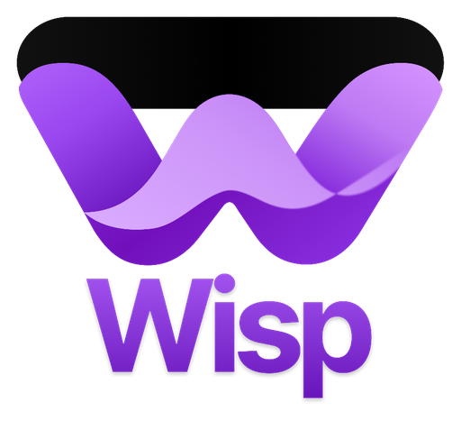
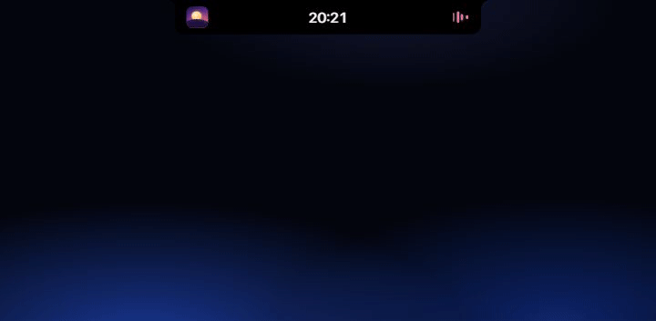
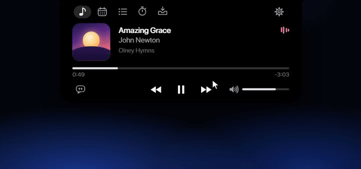
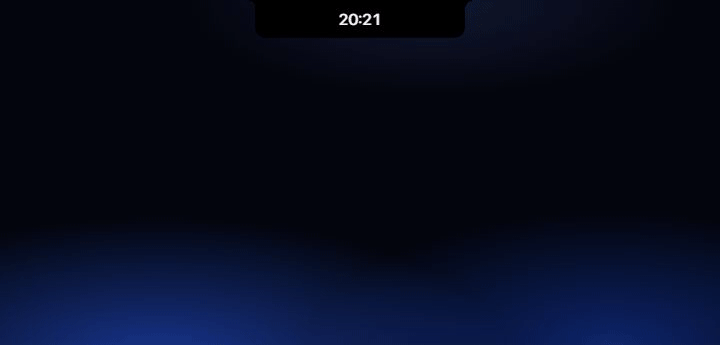

<div align="center">



**A Dynamic Island–style notch for Windows, inspired by Apple's design.**

What's playing, synced lyrics, notifications, a calendar, to-dos, a Pomodoro timer and a file shelf, all in a small notch at the top of your screen.


**[⬇ Download the latest release](https://github.com/kexlyu24/wisp/releases/latest)**

</div>

## Features

- 🎵 **Now Playing** for Spotify, Apple Music, Spotifast, the SoundCloud app, and Chrome or Edge, with artwork, seeking, controls and a volume slider for that app only
- 🎤 **Synced lyrics** in the panel and in the closed notch, from LRCLIB with NetEase as a fallback, cached for offline use
- 🔔 **Notifications** from any app pop up in the notch, and a Notification Center tab keeps the recent ones
- 📅 **Calendar** with your own events, ✅ **to-dos**, and a ⏱️ **Pomodoro** timer with adjustable lengths
- 📥 **File shelf**: drop files on the notch, drag them back out, and group them into folders
- 🪶 **Minimal mode**: shrinks to a sliver when it would hide something, like browser tabs
- 🚀 **Quick Access**: search and launch apps, or add your own shortcuts
- ⬆️ **In-app updates**: HTTPS downloads verified with SHA-256 from GitHub Releases, installed only when you click Restart & update
- ⚙️ **Settings** in a standalone dark-mode popup window (Notch, General, Appearance background themes, and Updates), opened from the notch gear button or tray icon, with spring-driven motion throughout

<table>
  <tr>
    <td></td>
    <td></td>
  </tr>
  <tr>
    <td></td>
    <td></td>
  </tr>
</table>

## Install

1. Download the zip from **[Releases](https://github.com/kexlyu24/wisp/releases/latest)** and unzip it.
2. Run `wisp.exe`. There's no installer. If Windows warns you, click **More info → Run anyway**, since the app isn't signed.
3. Hover the notch at the top of your screen. Settings and Quit are in the notch's gear button (standalone Settings popup) and in the tray icon.

Wisp uses Apple's **SF Pro Display** if you've [installed it](https://developer.apple.com/fonts/), and otherwise the built-in Inter font.

**Privacy:** application data stays in `%APPDATA%\Wisp`. Network requests include lyrics lookups (song title and artist), GitHub release checks, and update downloads when requested. Automatic update checks can be disabled in Settings → Updates. Notifications are read locally and never stored or sent.

## Local diagnostics

Wisp writes English diagnostic records to `%APPDATA%\Wisp\wisp.log`, with local
timestamps, severity, component and process ID. Logs rotate at 2 MiB and keep
three previous archives. They cover startup/shutdown, update operations, image
drops, data-file failures and selected integration errors. Repeated integration
errors are rate-limited. User text, clipboard content, full URLs and credentials
are not logged. Native crashes use a separate best-effort `wisp_crash.log`.
Logs stay local; share them manually when reporting a problem. Logging is
best-effort and may drop records during concurrent writes or abrupt termination.

## Browser image drops

Drag a direct HTTPS image from Chrome or Edge onto the shelf. Wisp downloads it
in the background, validates it and keeps a PNG copy in `%APPDATA%\Wisp\web-images`.
Local file drops still work. Supported sources are PNG/JPEG/WebP/BMP images up to
20 MiB and 8192 pixels per dimension. Sites requiring login, blob/data URLs and
SVG/GIF are not supported. Cached copies remain after removing a shelf item;
they can be deleted manually when no longer needed. Dropping web content sends
a request to that image host, without importing browser cookies.

## In-app updates

Settings → Updates provides stable-release checks, release notes, HTTPS downloads verified with SHA-256
and explicit Restart & update. No browser or account is required. Update packages
must be published by the maintainer; 0.2.1 is the first release with them, so
update from 0.2.0 or older by downloading the zip once. See [docs/UPDATES.md](docs/UPDATES.md) for packaging,
recovery limitations and the user-run verification checklist.

## Text editing

The Calendar event title, Quick Access search, and shortcut name/command fields
support the same selection, clipboard shortcuts, caret navigation and horizontal
scrolling as the To-do field. Existing Enter/Tab actions and character limits stay
unchanged (Calendar: 100; Quick Access fields: 80; To-do: 120).

### To-do

Click inside the task field to place the caret, or drag to select text. Use Left/Right,
Home/End (hold Shift to select), Ctrl+A/C/X/V, Backspace and Delete. Long drafts scroll
with the caret; Enter adds the task, and Escape leaves the draft without adding it.
The same shortcuts work in the Calendar and Quick Access fields listed above.

## Build

Needs [Rust](https://rustup.rs) with the `stable-x86_64-pc-windows-gnu` toolchain.

```bash
cargo build --release
```

```bash
cargo test
```

Every behavior, size and timing is documented in **[docs/BEHAVIOR.md](docs/BEHAVIOR.md)**. Pull requests go into `dev`.

## Contributors

<table>
  <tr>
    <td align="center" width="230">
      <a href="https://github.com/kexlyu24"></a><br>
      <a href="https://github.com/kexlyu24"><b>kexlyu24</b></a><br>
      <sub>🛠️ Creator &amp; maintainer</sub>
    </td>
    <td align="center" width="230">
      <a href="https://github.com/overhaulpxl"></a><br>
      <a href="https://github.com/overhaulpxl"><b>overhaulpxl</b></a><br>
      <sub>🔊 Volume · 📅 Calendar · ⚡ Performance</sub>
    </td>
    <td align="center" width="230">
      <a href="https://github.com/aoisaki01"></a><br>
      <a href="https://github.com/aoisaki01"><b>aoisaki01</b></a><br>
      <sub>🧩 Quick Access · 🎨 Background themes</sub>
    </td>
    <td align="center" width="230">
      <a href="https://github.com/levialavender"></a><br>
      <a href="https://github.com/levialavender"><b>levialavender</b></a><br>
      <sub>✏️ Text editing · ⬆️ Updater · 🖼️ Image drops</sub>
    </td>
  </tr>
</table>

Thanks for helping make Wisp better! Want to join? Open an issue, or a pull request into `dev`.

## Credits

Lyrics from [LRCLIB](https://lrclib.net) and NetEase Cloud Music. [Inter](https://rsms.me/inter/) font, SIL Open Font License 1.1. Inspired by Apple's Dynamic Island; not affiliated with Apple.

## License

[MIT](LICENSE)
